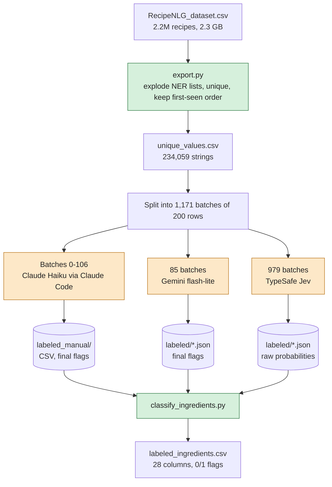
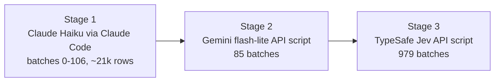
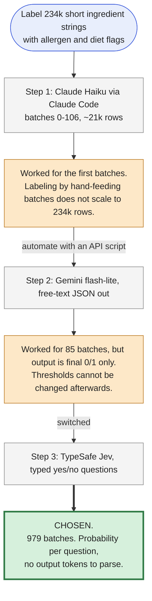
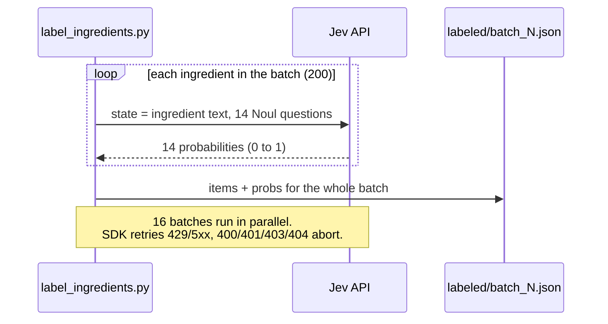
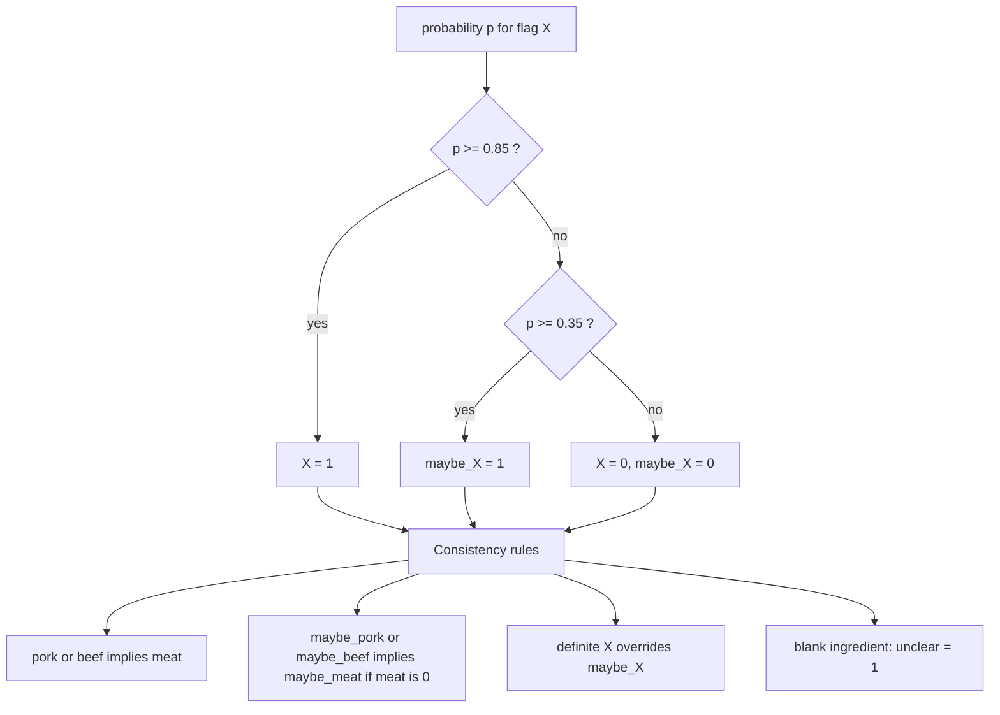
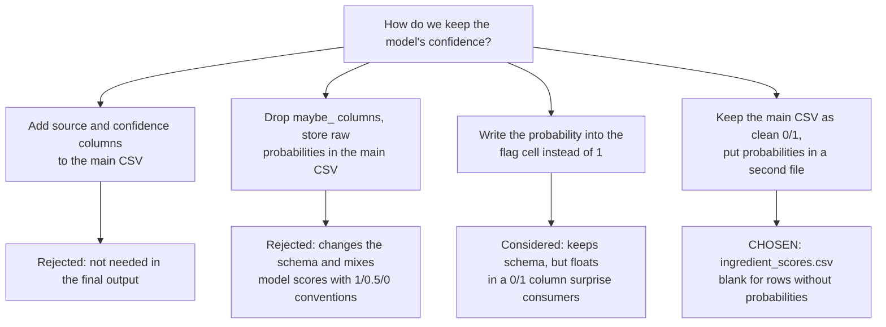
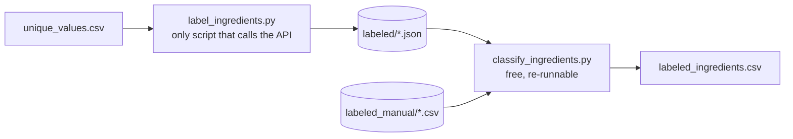

# Ingredient labeling: process and decisions

Goal: a lookup table that maps every unique ingredient string in the RecipeNLG dataset to allergen and diet
flags by *meaning*, not by substring matching ("coconut milk" is not dairy, "nutmeg" is not a tree nut).
Result: **234,059 rows** in `labeled_ingredients.csv`, 28 columns (12 definite flags, `protein_source`,
`unclear`, 12 `maybe_*` twins, `note`).

## 1. Pipeline overview

Orange = costs money (LLM calls). Green = free to re-run.

Batch *n* covers data rows `n*200 .. n*200+199` of `unique_values.csv`. Because batch numbers are positional,
`export.py` must keep first-seen order; sorting it would silently misalign every cached batch.

## 2. How labeling evolved

| Stage | Source | Output | Notes |
|---|---|---|---|
| 1 | Claude Haiku, run through Claude Code reading the batch files | `labeled_manual/batch_*.csv` | The folder name says "manual" but these are model labels, not human labels. Treat them as a strong reference, not ground truth. |
| 2 | Gemini `gemini-3.5-flash-lite`, 200 ingredients per request, JSON array out | `labeled/*.json` with final flags, confidence, notes | No probabilities, so these rows cannot be re-thresholded. |
| 3 | TypeSafe Jev, one call per ingredient | `labeled/*.json` with raw probabilities | Cheap and returns a probability per flag (not calibrated), so thresholds are tunable for free. |

## 3. Model choice

## 4. How a Jev call works

One ingredient is the *state*. The 14 flags (12 allergen/diet flags, `protein_source`, `unclear`) are 14
yes/no (`Noul`) questions, each with the labeling rules written into its instructions.

Why one call per ingredient: a Jev call evaluates questions against a single state. Packing 200 ingredients
into one state would need 2,800 questions that each point at an index, which is fragile.

## 5. Probabilities to flags

The thresholds `0.85` and `0.35` are untuned guesses. They live in `classify_ingredients.py` and can be changed
with `--t-definite` and `--t-maybe`. Re-running never calls the API.

## 6. Output design decisions

## 7. Script split

`label_ingredients.py` is resumable: cached and `labeled_manual/` batches are skipped, so re-running only does
what is missing. `TYPESAFE_API_KEY` is read from `../.env`.

## 8. Numbers

| Item | Value |
|---|---|
| Unique ingredient strings | 234,059 |
| Batches | 1,171 (200 rows each) |
| Claude Haiku batches | 107 (0-106), ~21.4k rows |
| Gemini batches | 85 |
| Jev batches | 979, ~196k rows |
| Jev model | `jev-latest`, price 0.042 USD per million input tokens |
| Smoke test | 2 batches (400 calls) in about 19 s |
| Cost of the Jev run | Estimated about ~ 9CAD |

## 9. Known limits and open items

- Jev thresholds are untuned. We skipped evaluation on purpose: this is a test project, and the only labels to
  compare against are Haiku's, so agreement would not mean correctness anyway.
- Jev tends to over-flag `maybe_*` (for example `maybe_meat` on "Florida eggs"). Raising `--t-maybe` trims it.
- Jev rows have an empty `note`; Haiku and Gemini rows keep theirs.
- Gemini rows are frozen (no probabilities), so threshold changes only affect the Jev rows.
- `least_sure_20.csv` was not useful: with about 196k Jev rows, the top 20 closest to 0.5 were all exact ties.

## 10. Files that were generated and then deleted

These existed during the work and were removed to save space or because they were derivable. None is needed
to reproduce the main table.

| File | What it was | How to get it back |
|---|---|---|
| `ingredient_scores.csv` | Raw Jev probability per flag, blank for Haiku and Gemini rows | `python classify_ingredients.py` |
| `least_sure_20.csv` | 20 Jev rows with a flag closest to 0.5 | `python classify_ingredients.py` (output was all ties) |
| `labeled_manual_combined.csv` | The Haiku batches concatenated | concatenate `labeled_manual/*.csv` |
| `least_sure_20_manual.csv` | Review sample from the Haiku phase | not needed |

Note: `classify_ingredients.py` still writes `ingredient_scores.csv` and `least_sure_20.csv` on every run.
